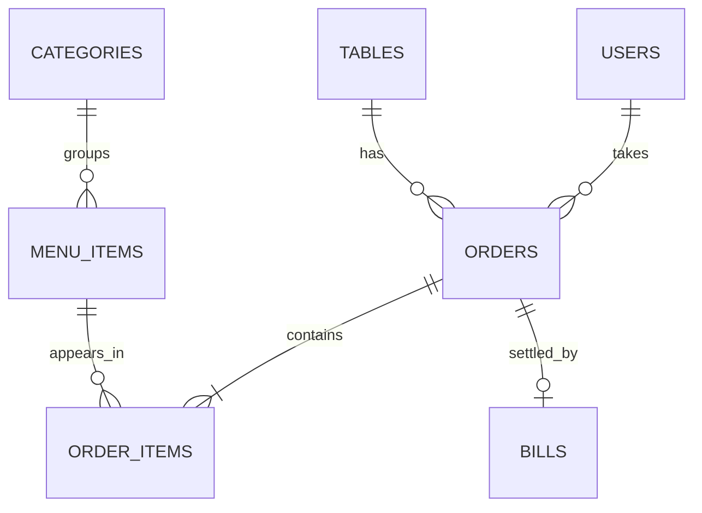

# 🍽️ Smart Restaurant POS & Billing System

A **Python Tkinter-based desktop application** developed to simplify restaurant operations through an interactive, user-friendly Graphical User Interface (GUI).

The application allows restaurant staff to manage tables, take orders, generate bills, manage menus and monitor restaurant activities. MySQL is used as the backend database for storing application data.

---

## 👩‍🎓 Student Details

| Field | Details |
|---|---|
| Name | Eshita Biswas |
| Registration Number | RA2511003012357 |
| Project Title | Smart Restaurant POS & Billing System |

---

# 1. Project Overview

The Smart Restaurant POS & Billing System is a desktop-based restaurant management application developed using **Python and Tkinter**.

The primary focus of this project is GUI development. Tkinter is used to create interactive windows, buttons, labels, forms, tables, navigation panels and other interface components.

The application provides a centralized platform for restaurant staff to perform daily operations through a graphical interface instead of handling everything manually.

MySQL is integrated as a supporting technology to store and retrieve application information.

# 2. Technologies Used

| Technology | Purpose |
|---|---|
| Python | Main programming language |
| Tkinter | Graphical User Interface development |
| ttk | Enhanced GUI widgets and tables |
| MySQL | Backend data storage |
| mysql.connector | Python–MySQL connectivity |
| HTML | Printable invoice generation |
| CSV | Report export |

# 3. Graphical User Interface Features

The application consists of nine main screens.

### 3.1 Login Screen
- User-friendly login window.
- Admin and Cashier authentication.
- Password-protected access.
- Role-based navigation.

### 3.2 Dashboard
- Displays restaurant activity and sales information.
- Interactive dashboard cards.
- Sales charts and visual statistics.
- Low-stock notifications.
- Demo data loading option.

### 3.3 Table Management
- Displays restaurant tables in a visual grid.
- Shows Free, Occupied and Billing status.
- Includes a time-seated timer.
- Allows staff to select tables and manage orders.

### 3.4 Order Management
- Interactive food menu display.
- Category filters and search functionality.
- Add and manage food items.
- Quantity and stock validation.
- Smart food recommendations.

### 3.5 Billing Screen
- Automatic bill calculation.
- Discount application.
- GST calculation.
- Cash, Card and UPI payment options.
- Automatic round-off and cash change calculation.

### 3.6 Receipt Window
- Displays generated invoices.
- Printable HTML receipts.
- Option to print or save invoices as PDF.
- Invoice reprinting.

### 3.7 Menu Management
- Add new food items.
- Edit existing dishes.
- Manage categories.
- Update prices and stock.
- Hide or delete menu items.

### 3.8 Staff Management
- Create staff accounts.
- Assign Admin and Cashier roles.
- Reset passwords.
- Enable or disable accounts.

### 3.9 Reports Screen
- Date-range sales reports.
- Daily sales information.
- Best-selling items.
- Payment statistics.
- CSV report export.

# 4. Tkinter Components Used

Tkinter provides the graphical elements used to build the application's interface.

| Tkinter Component | Purpose |
|---|---|
| `Tk()` | Creates the main application window |
| `Frame` | Organizes different sections of the interface |
| `Label` | Displays text and headings |
| `Button` | Performs actions when clicked |
| `Entry` | Accepts user input |
| `ttk.Treeview` | Displays tabular information |
| `ttk.Combobox` | Provides dropdown selections |
| `messagebox` | Displays alerts and confirmation messages |
| `Canvas` | Creates graphical dashboard elements |
| `Toplevel` | Creates additional windows and dialogs |

### GUI Implementation

- **Widget-based design:** Different Tkinter widgets are combined to create the application interface.
- **Event-driven programming:** Buttons and other components respond to user actions through event handlers.
- **Modular screens:** Each major screen is maintained in a separate Python file.
- **Interactive navigation:** Users can move between different application sections.
- **User-friendly layout:** Frames, labels, buttons and tables organize the information clearly.

# 5. Project Structure

The project follows a modular structure to separate the graphical interface, application logic and database operations.

```text
smart_pos_mysql/
│
├── main.py
├── config.py
├── check_mysql.py
├── requirements.txt
├── run_app.bat
├── schema.sql
│
├── database/
│   ├── __init__.py
│   ├── db.py
│   └── queries.py
│
├── services/
│   ├── __init__.py
│   ├── auth.py
│   ├── security.py
│   ├── billing.py
│   ├── receipt.py
│   ├── menu_service.py
│   ├── staff_service.py
│   ├── export.py
│   └── demo_data.py
│
└── ui/
    ├── __init__.py
    ├── login_screen.py
    ├── dashboard.py
    ├── tables_screen.py
    ├── order_screen.py
    ├── billing_screen.py
    ├── receipt_window.py
    ├── menu_manager.py
    ├── staff_screen.py
    ├── reports_screen.py
    ├── orders_list.py
    ├── charts.py
    └── widgets.py
```

### Explanation of Directories

| File / Directory | Description |
|---|---|
| `main.py` | Entry point of the application |
| `config.py` | Stores application settings |
| `ui/` | Contains Tkinter screens and GUI components |
| `services/` | Handles application logic such as billing and authentication |
| `database/` | Handles MySQL connectivity and database queries |
| `schema.sql` | Contains the database schema |
| `requirements.txt` | Lists project dependencies |
| `run_app.bat` | Windows application launcher |

# 6. Backend Database

MySQL is used as the supporting database to maintain application information.

The application uses seven main tables:

| Table | Purpose |
|---|---|
| `users` | Stores user accounts and roles |
| `categories` | Stores menu categories |
| `menu_items` | Stores food items, prices and stock |
| `tables` | Stores restaurant table information |
| `orders` | Stores customer orders |
| `order_items` | Stores individual order details |
| `bills` | Stores invoice and payment information |

### Database Relationships



The database supports the Tkinter application by maintaining information between operations.

# 7. How to Run the Project

### Requirements
- Python 3.10 or newer.
- MySQL Server.
- Visual Studio Code or another Python IDE.

### Step 1: Install Dependencies

```bash
pip install -r requirements.txt
```

### Step 2: Configure MySQL

Open `config.py` and enter your MySQL credentials.

```python
MYSQL_USER = "root"
MYSQL_PASSWORD = "your password"
```

### Step 3: Check Database Connection

```bash
python check_mysql.py
```

### Step 4: Run the Application

```bash
python main.py
```

Alternatively, double-click `run_app.bat` on Windows.

The database and required tables are initialized automatically when the application starts.

# 8. Demo Login Credentials

| Role | Username | Password |
|---|---|---|
| Admin | `admin` | `admin123` |
| Cashier | `cashier` | `cash123` |

These are demonstration credentials. Change them before real-world use.

# 9. Suggested Project Demonstration

1. Open the application and demonstrate the login screen.
2. Log in as Admin and explore the dashboard.
3. Demonstrate restaurant table management.
4. Select a table and add food items through the order screen.
5. Demonstrate Kitchen Order Tickets (KOT).
6. Generate a bill and demonstrate payment options.
7. Display and print the generated receipt.
8. Demonstrate menu and staff management.
9. Open the reports screen and export a CSV report.

# 10. Design and Implementation

- **GUI-based design:** Tkinter is used to develop the interactive desktop interface.
- **Modular architecture:** Different screens and functionalities are maintained in separate Python files.
- **Event-driven programming:** Buttons, forms and other widgets respond to user actions.
- **Backend integration:** MySQL stores and manages application data.
- **Security:** Passwords are protected using salted PBKDF2 hashing.
- **Billing automation:** The application calculates totals, discounts and taxes automatically.
- **Data management:** Menu items, orders, staff and billing information are maintained through the application.

# 11. Future Enhancements

- Improved GUI animations and visual effects.
- Online food ordering integration.
- Cloud-based database connectivity.
- Mobile application support.
- Multi-branch restaurant management.
- Online payment gateway integration.

---

## Developed Using

**Python | Tkinter | MySQL**

*Smart Restaurant POS & Billing System — A GUI-based restaurant management application.*
