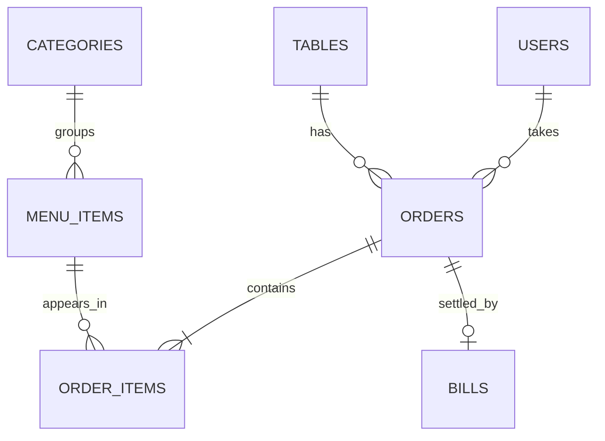

# Smart Restaurant POS & Billing System

A desktop Point-of-Sale and billing application for restaurants, built with
**Python, Tkinter and MySQL**.

## Features

**Front of house**
- Secure login with two roles: **Admin** and **Cashier** (salted PBKDF2 password hashing)
- Live table grid (Free / Occupied / Billing) with a "time seated" timer
- Order screen with category filters, search, best-sellers-first menu and stock limits
- **Kitchen Order Tickets (KOT)** that list only the newly added items
- **Smart suggestions** ("Goes well with...") learned from past bills

**Billing**
- Discount (% or flat), GST split into CGST/SGST, automatic round-off
- Cash (with change calculation), Card and UPI payments
- Unique invoice numbers, atomic save (bill + table + stock in one transaction)
- Printable HTML invoice (print or save as PDF) and invoice reprint

**Admin**
- Dashboard with animated charts: 7-day sales, best sellers, payment split, low stock
- **Menu Manager**: add / edit / hide / delete dishes, manage categories
- **Staff**: add accounts, change roles, disable accounts, reset passwords
- **Reports**: date-range filter, totals, daily sales, items sold, sales by category,
  **CSV export** (opens in Excel)
- One-click **demo data** so charts and suggestions can be shown instantly

## How to run

1. Install Python 3.10 or newer (tick "Add Python to PATH") and **MySQL Server**.
2. Install the MySQL connector (once):

       pip install mysql-connector-python

3. Open `config.py` and set your MySQL details:

       MYSQL_USER = "root"
       MYSQL_PASSWORD = "your password"

4. Check the connection:  `python check_mysql.py`
5. Start the app:  `python main.py`  (or double-click `run_app.bat`)

The database `smart_pos`, all tables and sample data are created automatically
on first run. `schema.sql` contains the same tables if you want to view them in
MySQL Workbench.

| Role    | Username  | Password   |
|---------|-----------|------------|
| Admin   | `admin`   | `admin123` |
| Cashier | `cashier` | `cash123`  |

Change these from **Staff -> Reset password** before real use.

## Suggested demo script

1. Log in as `admin`, click **Load demo data** on the dashboard.
2. Show the charts, then **Tables -> Table 1**, add *Butter Chicken* and use the
   "Goes well with" suggestion.
3. **Send to Kitchen (KOT)**, then **Generate Bill**, apply 10% discount, pay by Cash.
4. Open the printable bill. Open **Reports**, filter by date, export CSV.
5. **Menu Manager**: add a new dish. **Staff**: add a cashier.
6. Click **Clear** on the dashboard to remove the demo data.

## Project structure

    main.py                 starts the app, switches screens
    config.py               restaurant name, GST rate, colours
    database/
        db.py               MySQL connection, schema, sample data
        queries.py          every SQL statement (UI never writes SQL)
    services/
        auth.py security.py login + password hashing
        billing.py          bill maths and rounding
        receipt.py          text and HTML invoices
        menu_service.py staff_service.py   validation and rules
        export.py demo_data.py             CSV export, sample data
    ui/                     one file per screen (login, dashboard, tables,
                            order, billing, reports, menu manager, staff)

## Database (MySQL)

    users(id, username, full_name, password_hash, role, active)
    categories(id, name)
    menu_items(id, name, category_id -> categories, price, available, stock)
    tables(id, table_no, capacity, status)
    orders(id, table_id -> tables, user_id -> users, status, created_at)
    order_items(id, order_id -> orders, item_id -> menu_items, quantity, price, kot_qty)
    bills(id, order_id -> orders, invoice_no, subtotal, gst, discount, total,
          payment_mode, paid_at)

## Design notes

- **Layers:** UI -> services (rules) -> queries (SQL) -> MySQL. Each layer only talks to the next.
- **Prices are copied** into `order_items`, so changing a menu price never alters old bills.
- **Deleting a dish** that appears on past bills hides it instead, keeping history intact.
- **Safety rules:** no double billing, no ordering beyond stock, the last admin cannot be
  removed, and you cannot disable your own account.
