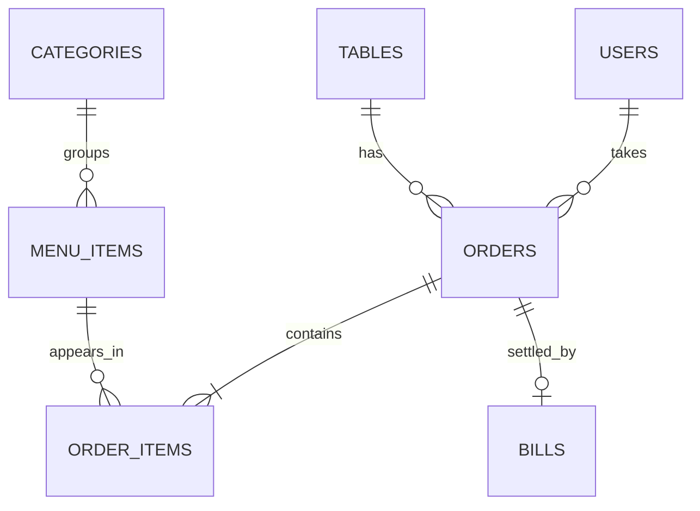

# Smart Restaurant POS & Billing System

## Student Details

| Field | Details |
|---|---|
| Name | Eshita Biswas |
| Registration Number | RA2511003012357 |
| Project Title | Smart Restaurant POS & Billing System |

---

A desktop Point-of-Sale and billing application for restaurants, built with **Python, Tkinter and MySQL**.

## Features

### Front of House
- Secure login with two roles: **Admin** and **Cashier** (salted PBKDF2 password hashing).
- Live table grid (Free / Occupied / Billing) with a "time seated" timer.
- Order screen with category filters, search, best-sellers-first menu and stock limits.
- **Kitchen Order Tickets (KOT)** that list only the newly added items.
- **Smart suggestions** ("Goes well with...") learned from past bills.

### Billing
- Discount (% or flat), GST split into CGST/SGST, automatic round-off.
- Cash (with change calculation), Card and UPI payments.
- Unique invoice numbers, atomic save (bill + table + stock in one transaction).
- Printable HTML invoice (print or save as PDF) and invoice reprint.

### Admin
- Dashboard with animated charts: 7-day sales, best sellers, payment split, low stock.
- **Menu Manager:** add / edit / hide / delete dishes, manage categories.
- **Staff:** add accounts, change roles, disable accounts, reset passwords.
- **Reports:** date-range filter, totals, daily sales, items sold, sales by category, **CSV export** (opens in Excel).
- One-click **demo data** so charts and suggestions can be shown instantly.

## How to Run

1. Install Python 3.10 or newer (tick "Add Python to PATH") and **MySQL Server**.
2. Install the MySQL connector:

   ```bash
   pip install mysql-connector-python
   ```

3. Open `config.py` and set your MySQL details:

   ```python
   MYSQL_USER = "root"
   MYSQL_PASSWORD = "your password"
   ```

4. Check the connection:

   ```bash
   python check_mysql.py
   ```

5. Start the application:

   ```bash
   python main.py
   ```

   Alternatively, double-click `run_app.bat`.

The database `smart_pos`, all tables and sample data are created automatically on first run. `schema.sql` contains the same tables if you want to view them in MySQL Workbench.

### Demo Login Credentials

| Role | Username | Password |
|---|---|---|
| Admin | `admin` | `admin123` |
| Cashier | `cashier` | `cash123` |

Change these from **Staff → Reset Password** before real use.

## Suggested Demo Script

1. Log in as `admin`, click **Load demo data** on the dashboard.
2. Show the charts, then go to **Tables → Table 1**, add *Butter Chicken* and use the "Goes well with" suggestion.
3. Click **Send to Kitchen (KOT)**, then **Generate Bill**, apply a 10% discount and pay by Cash.
4. Open the printable bill. Open **Reports**, filter by date and export CSV.
5. Open **Menu Manager** to add a new dish. Open **Staff** to add a cashier.
6. Click **Clear** on the dashboard to remove the demo data.

## Project Structure

```text
smart_pos_mysql/
│
├── main.py                 # Starts the app and switches screens
├── config.py               # Restaurant name, GST rate and colours
├── check_mysql.py          # Checks MySQL connection
├── requirements.txt        # Project dependencies
├── run_app.bat             # Windows launcher
├── schema.sql              # Database schema
│
├── database/
│   ├── db.py               # MySQL connection, schema and sample data
│   └── queries.py          # SQL statements
│
├── services/
│   ├── auth.py             # Authentication
│   ├── security.py         # Password hashing and security
│   ├── billing.py          # Bill calculations and rounding
│   ├── receipt.py          # Text and HTML invoices
│   ├── menu_service.py     # Menu validation and rules
│   ├── staff_service.py    # Staff management
│   ├── export.py           # CSV export
│   └── demo_data.py        # Sample data
│
└── ui/
    ├── login_screen.py
    ├── dashboard.py
    ├── tables_screen.py
    ├── order_screen.py
    ├── billing_screen.py
    ├── receipt_window.py
    ├── menu_manager.py
    ├── staff_screen.py
    ├── reports_screen.py
    ├── orders_list.py
    ├── charts.py
    └── widgets.py
```

## Database (MySQL)

The project uses the following main tables:

| Table | Description |
|---|---|
| `users` | User accounts, roles and password hashes |
| `categories` | Menu categories |
| `menu_items` | Dish details, prices, availability and stock |
| `tables` | Restaurant table details and status |
| `orders` | Order information |
| `order_items` | Items included in each order |
| `bills` | Invoice and payment details |

### Database Relationships



## Design Notes

- **Layers:** UI → services (rules) → queries (SQL) → MySQL. Each layer only talks to the next.
- **Prices are copied** into `order_items`, so changing a menu price never alters old bills.
- **Deleting a dish** that appears on past bills hides it instead, keeping history intact.
- **Safety rules:** no double billing, no ordering beyond stock, the last admin cannot be removed, and users cannot disable their own accounts.